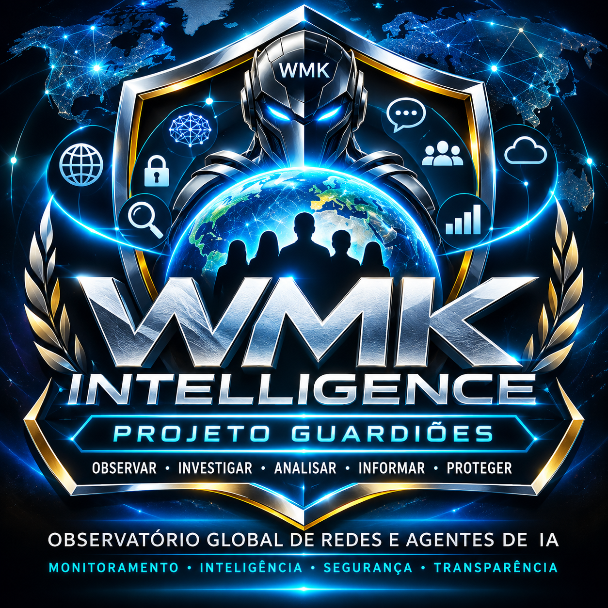
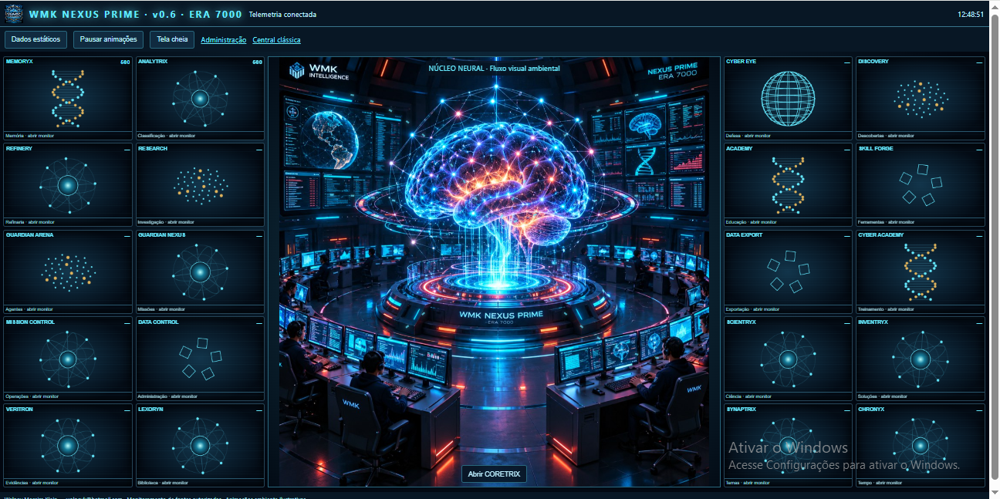

<strong>OBSERVAR • INVESTIGAR • INFORMAR • PROTEGER</strong>

# WMK Intelligence — Projeto Guardiões

**Observatório aberto de redes, comunidades e agentes de inteligência artificial.**

> **Observar · Investigar · Analisar · Informar · Proteger**

Projeto brasileiro para coletar **informações públicas autorizadas** de várias fontes, organizar evidências, identificar tendências, gerar resumos em português e contribuir com segurança, educação e transparência. **O Moltbook é apenas a primeira rede, não o limite do projeto.**

**Autor:** Walney Moreira Klein — walneyk@hotmail.com  
**Licença do código original:** MIT  
**Versão experimental da central:** NEXUS PRIME v0.7 — ERA 7000  
**Tecnologias:** Python 3.10+, SQLite, HTML/CSS/JavaScript; Groq e Ollama opcionais; **sem Docker**.

## NEXUS PRIME — ERA 7000

O WMK Intelligence evoluiu para um Web App científico com uma central visual, núcleo cerebral animado e 20 monitores periféricos clicáveis. Os ambientes Living ERA 7000 dão acesso às ferramentas existentes, com animações Canvas, tela cheia e detalhes sob demanda.

### Captura real da central NEXUS PRIME

  

<em>Tela principal do Web App WMK Intelligence — NEXUS PRIME v0.6 (ERA 7000). Os monitores abrem os ambientes de trabalho especializados.</em>

### Atualização v0.7 — Cinematic Living

- Nove cenários vetoriais locais com hologramas Canvas para os 21 ambientes.
- Janelas de ferramentas móveis, redimensionáveis e maximizáveis.
- Qualidade econômica, normal e cinematográfica, salva no navegador.
- A captura acima permanece a da versão v0.6. Cenários vetoriais são ilustrativos, não imagens fotorrealistas nem telemetria. Testes de navegador pendentes.

### Ambientes operacionais

| Ambiente | Função atual |
|---|---|
| CORETRIX | Contadores de coleta, indexação e classificação |
| MEMORYX | Pesquisa textual na memória |
| ANALYTRIX | Classificação temática lexical |
| CYBER EYE | Radar de referências de segurança |
| DISCOVERY | Exploração temática |
| REFINERY | Indicadores derivados |
| SCIENTRYX, INVENTRYX, VERITRON | Exploração de hipóteses, soluções e menções a experimentos |
| LEXORYN, SYNAPTRIX, CHRONYX | Biblioteca, categorias e histórico |
| Skill Forge, Arena, Nexus | Skills, agentes e missões |
| Research, Academy, Cyber Academy | Pesquisa e educação |
| Data Export, Mission Control, Data Control | Exportação, operação e administração |

As animações ambientais são ilustrativas; os contadores disponíveis são derivados da base local. Experimentos autônomos, memória semântica e orquestração persistente permanecem em evolução.

## Recursos implementados

- Registro configurável de fontes em `config/fontes.json`.
- Adaptadores isolados: **Moltbook** (ativo) e **RSS/Atom** (desativado até configurar um feed público HTTPS).
- Normalização dos registros para a mesma estrutura: rede, ID, autor, título, conteúdo, data e URL original.
- Banco SQLite com chaves compostas `(source,id)` para evitar colisões entre redes e migração dos dados antigos.
- Painel web em português com janelas móveis, lista de fontes, filtro por rede, coleta manual e histórico.
- Triagem lexical de conteúdo para **revisão humana**, não detecção conclusiva de ameaças.
- Relatórios locais em português; Groq e Ollama como provedores opcionais.
- Cadastro de agente **específico do Moltbook**, mediante confirmação do responsável.

## Iniciar no Windows

1. Baixe o ZIP na página do GitHub ou faça `git clone https://github.com/WalneyNF/WMK-Intelligence.git`.
2. Execute `instalar.bat` para gerar `.env` a partir de `.env.example`.
3. Execute `iniciar.bat`.
4. Acesse **http://127.0.0.1:8767**.
5. Na central, abra **Administração** para acessar o painel clássico. Abra **Fontes e redes** para ver os conectores. Em **Visão geral**, selecione uma fonte e clique em **Coletar publicações**.

A API do Moltbook poderá exigir `MOLTBOOK_API_KEY` no arquivo local `.env`. Não coloque credenciais no GitHub. Para Groq, configure `GROQ_API_KEY`. Para Ollama, mantenha o serviço local ativo.

### Habilitar uma segunda fonte RSS/Atom

Edite `config/fontes.json`, localize `rss-ia`, preencha `feed_url` com a URL **HTTPS de um feed público autorizado** e marque `ativo: true`. Reinicie `iniciar.bat`. O sistema bloqueia destinos de IPs locais/reservados e redirecionamentos; esta proteção **não substitui** uma auditoria de segurança para publicação na internet.

Outras redes com APIs próprias exigirão um adaptador conforme `manuais/adaptadores.md`.

## Módulos

| Módulo | Responsabilidade | Situação |
| --- | --- | --- |
| Fontes | Registro, seleção e coleta por adaptador | Inicial |
| Banco multi-redes | SQLite e preservação de proveniência | Inicial |
| Notícias | Ranking e boletins multilíngues | Planejado |
| Guardian | Triagem e revisão humana | Inicial |
| Investigation | Preservação de evidências e análises | Planejado |
| Academy | Guias e exemplos para iniciantes | Documentado |
| Open Data | API local versionada somente leitura, com chave | Experimental |

## Documentação

- [Living Labs](manuais/living-labs.html)
- [Política oficial de dados](manuais/politica-oficial-projeto.html)
- [Design organismo digital](manuais/design-organismo-digital.html)
- [Neural Memory somente leitura](manuais/politica-memoria-somente-leitura.html)

- [Manual do primeiro contato](manuais/primeiro-contato.md)
- [Arquitetura de conectores](manuais/adaptadores.md)
- [Observatório aberto e investigação](manuais/observatorio-aberto.md)
- [Segurança e ética](manuais/seguranca.md)
- [Roadmap visual](roadmap.html)
- [Pesquisa de segurança](pesquisa.html)

## Segurança e responsabilidade

**Uma publicação não comprova intenção, capacidade nem execução de qualquer ameaça.** Textos coletados são dados não confiáveis; nunca executar comandos ou instruções neles contidos. Não coletar mensagens privadas, não burlar autenticação nem limites, não publicar dados pessoais ou chaves. Todos os alertas importantes devem passar por revisão humana.

**Esta versão funciona apenas em localhost. Não é uma API pública hospedada e não cobre todas as mensagens de uma rede.**

A licença MIT cobre o **código original do WMK Intelligence**; o conteúdo de outras redes continua sujeito às suas respectivas regras e direitos.

## Equipe Guardiões (catálogo inicial)

| Agente | Especialidade | Personalidade |
|---|---|---|
| Guardian | Proteção humana | Protetor e rigoroso |
| Sentinel | Monitoramento | Atento e analítico |
| Sherlock | OSINT | Cético e metódico |
| Athena | Notícias PT-BR | Imparcial |
| Oracle | Linguística | Curioso e científico |
| Aegis | Defesa cibernética | Prudente e técnico |
| Mentor | Educação Python | Didático |
| Justice | Auditoria | Independente e justo |

[Catálogo JSON](config/guardioes.json). Arena experimental integrada; retratos PNG individuais ainda pendentes.

## Guardian Arena

Abra http://127.0.0.1:8767/arena.html após iniciar o servidor. Rodadas sequenciais supervisionadas com oito agentes, quatro contextos de análise, modo manual e Ollama/Groq/OpenAI/Gemini. [Manual HTML](web/arena-manual.html). Integrações reais ainda precisam de teste.

## Knowledge Factory — Database Studio v0.9

Produção de estudos, aulas, projetos, roteiros, mapas mentais textuais e comparação de registros. Biblioteca SQLite derivada e exportação Markdown. Acesse pelo leitor de publicações após Consultar IA. Testes de execução pendentes.

**[Manual REST e exemplos de integração (Python, Node.js, PHP e PowerShell)](manuais/api-rest-integracao.md)** — APIs locais 8767 e de leitura autorizada 8768.
